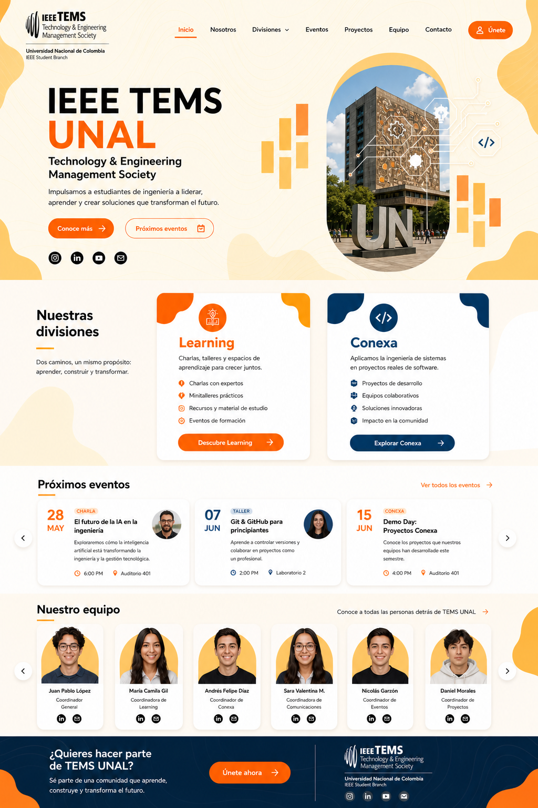

<h1 align="center">
  IEEE TEMS UNAL - Sitio web oficial
</h1>

<p align="center">
  Sitio web oficial del capítulo estudiantil IEEE TEMS de la Universidad Nacional de Colombia.
</p>

<p align="center">
  
</p>

Frontend desarrollado con **Astro**, **TailwindCSS** y **TypeScript**. El contenido dinámico se administra desde [tems-page-cms](https://github.com/TEMSUNAL/tems-page-cms) (Strapi).

## Objetivos

- Presentar el capítulo a estudiantes de la UNAL
- Mostrar eventos próximos
- Facilitar reclutamiento
- Exponer proyectos del equipo

## Stack

Astro · TailwindCSS · TypeScript · PNPM · Biome

## Inicio rápido

```bash
gh repo clone TEMSUNAL/tems-page
cd tems-page
pnpm install
pnpm run dev  # http://localhost:4321
```

Detalles en [CONTRIBUTING.md](CONTRIBUTING.md).

## Documentación

- **[Cómo contribuir](CONTRIBUTING.md)** - Setup local y flujo
- **[Estructura del proyecto](docs/project-structure.md)** - Dónde va qué
- **[Strapi](docs/strapi-consumption.md)** - Integración con CMS
- **[Despliegue](docs/deploy-netlify.md)** - Netlify y rebuild automático desde Strapi
- **[Git Workflow](docs/git-workflow.md)** - Ramas y commits

## Convenciones

| Aspecto | Patrón |
|---------|--------|
| Componentes | PascalCase: `HeroSection.astro` |
| Diseño | Mobile first, TailwindCSS |
| Commits | Conventional Commits |
| Colores | Naranja `#F85F03` · Azul `#013763` |

## Despliegue

- Frontend: Netlify (`netlify.toml`)
- CMS: [tems-page-cms](https://github.com/TEMSUNAL/tems-page-cms) (Strapi)
- Cada publicación en Strapi dispara un rebuild en Netlify vía build hook. Ver [docs/deploy-netlify.md](docs/deploy-netlify.md).